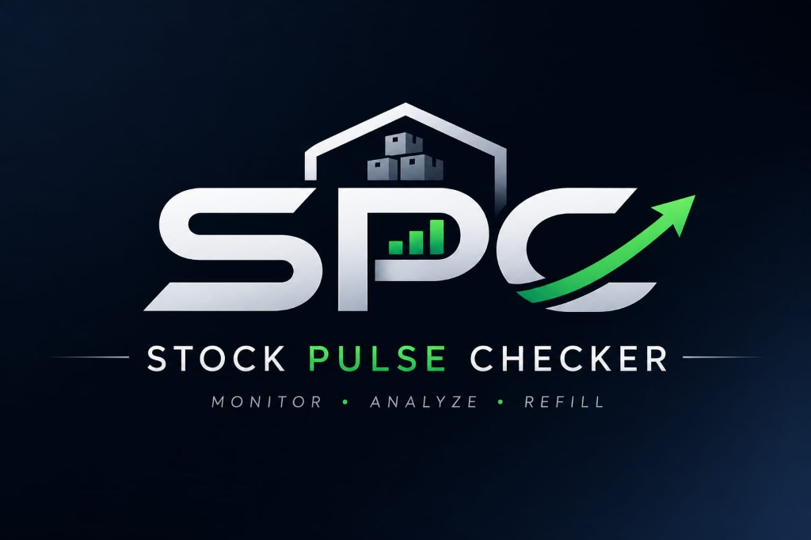

<div align="center">



# 📦 StockPulse Checker (SPC)
### Smart Inventory Demand Predictor & Point-of-Sale (POS) System

**Full-Stack Industry Project: Core Java Demand Engine + React Glassmorphism UI + MySQL Database**

[](https://www.oracle.com/java/)
[](https://react.dev/)
[](https://vitejs.dev/)
[](https://www.mysql.com/)

</div>

---

## 📌 Project Overview

**StockPulse Checker (SPC)** is an enterprise-grade, dual-architecture inventory forecasting and point-of-sale platform built for retail environments. It provides an intuitive, real-time **React 19 Glassmorphism UI** for store managers and cashiers, backed by a high-throughput **Core Java OOP & REST Microservice Engine** connected to a **MySQL 8.0 relational database**.

It is engineered to eliminate retail stockouts, automate purchase order replenishment using real historical sales velocity, ensure ACID transactional safety at checkout, and manage Cash-on-Delivery (COD) dispatch pipelines.

---

## ⚡ Key Features

- **Dual-Architecture Runtime:**
  - **Full-Stack Web App:** Modern React Glassmorphism frontend communicating with a standalone Java REST API server running on port `8080`.
  - **Terminal-Based CLI (`InventoryTerminalApp`):** Direct console-based interface for rapid evaluation, inventory audits, and academic viva demonstrations.

- **Intelligent Demand Predictor & ROP Engine:**
  - Proprietary replenishment engine analyzing supplier lead times, sales velocity, and safety buffers.
  - Automatically flags items requiring urgent vendor reorders before stockouts occur.
  - Computes optimal purchase batch sizes to maintain target shelf coverage while minimizing holding costs.
  - Provides real-time stock runout projections to prioritize immediate restocking needs.

- **Point of Sale (POS) & Atomic Sales Register:**
  - Categorized product selection shelf with real-time stock alerts.
  - Multi-channel checkout: Dynamic UPI QR simulator with live timer, Credit Card modal, and Cash on Delivery (COD).
  - Atomic database transactions with strict ACID guarantees preventing race conditions and stock over-deduction.

- **Cash on Delivery (COD) & Deliveries Hub:**
  - Dedicated `/deliveries` tracking pipeline to monitor pending vs. collected cash.
  - 1-Click order voiding that cancels invoices and automatically re-credits physical stock back to inventory.

- **Dual Theme Glassmorphism UI:**
  - Responsive Dark Mode and Light Mode with frosted-glass aesthetic.
  - Instant client-side PDF tax invoice generation with complete tax breakdowns.

---

## 🛡️ The 4 Core Inventory & Forecasting Rules

1. **Reorder Point (ROP) Rule:** Whenever shelf inventory approaches calculated safety depletion thresholds, the system triggers an urgent restocking flag so shelves never empty while waiting for supplier transit.
2. **ACID Transaction Rule:** Every sale execution checks stock availability and decrements units within an isolated SQL transaction. If stock is insufficient, the transaction terminates with `ROLLBACK`, guaranteeing zero negative stock.
3. **30-Day Target Restock Rule:** Recommended order quantities dynamically balance inventory to 30 days of forward demand based on moving average sales velocity, avoiding both overstock holding costs and stockout penalties.
4. **Reversal & Void Integrity Rule:** Cancelling a delivery or voiding an invoice triggers a compensating database transaction that restores physical units to inventory and logs the audit event.

---

## 📁 Repository Structure

```text
Stock-Pulse-Checker/
├── 1-Database-MySQL/
│   ├── smart schema.sql             # MySQL 8.0 DDL: tables, indexes, constraints
│   └── seed_data.sql                # Realistic initial catalog, sales & movements data
├── 2-Backend-Java/
│   ├── bin/                         # Compiled Java bytecode (.class)
│   ├── lib/
│   │   └── mysql-connector-j-9.1.0.jar # MySQL JDBC Type-4 driver
│   ├── src/com/inventory/
│   │   ├── MainServer.java          # Standalone Java HTTP REST server (:8080)
│   │   ├── InventoryTerminalApp.java # Interactive terminal CLI for viva / headless use
│   │   ├── controller/
│   │   │   ├── HttpApiServer.java   # HTTP REST routes, CORS & endpoints
│   │   │   └── JsonUtil.java        # Custom native JSON serialization engine
│   │   ├── dao/                     # Data Access Object layer (Product, Sales, Stock, Category)
│   │   │   ├── DBConnection.java    # JDBC connection factory
│   │   │   ├── ProductDAO.java      # Product CRUD & stock queries
│   │   │   ├── SalesDAO.java        # Transactional sales & invoice operations
│   │   │   └── StockMovementDAO.java # Stock IN/OUT audit trail logger
│   │   ├── model/                   # POJO domain models (Product, Category, Sale, Recommendation)
│   │   └── service/                 # Business logic: DemandPredictorService, InventoryService
│   ├── compile.bat                  # 1-Click Java build script
│   ├── run.bat                      # 1-Click launcher: Java HTTP REST Server (:8080)
│   └── run-terminal.bat             # 1-Click launcher: Interactive Terminal CLI
├── smart-inventory-pro/             # React 19 + Vite Frontend Application
│   ├── src/
│   │   ├── components/              # Dashboard, POS, Deliveries, DemandPredictor, Catalog
│   │   ├── services/api.js          # REST client communicating with Java backend
│   │   ├── App.jsx                  # Main application container & theme toggler
│   │   └── index.css                # Glassmorphic CSS styling (Dark / Light mode)
│   ├── package.json                 # Frontend dependencies & scripts
│   └── vite.config.js               # Vite bundler configuration
├── assets/                          # SPC brand emblem & visual assets for GitHub
│   ├── spc-logo.jpg                 # StockPulse Checker logo
│   └── spc-hero-banner.jpg          # System overview hero graphic
└── README.md                        # Project documentation
```

---

## 🔌 REST API Endpoints

The Java backend exposes a high-performance HTTP REST API on port `8080`:

| Method | Endpoint | Description |
|---|---|---|
| `GET` | `/api/health` | Healthcheck and server status |
| `GET` | `/api/dashboard` | Executive KPI telemetry, low-stock counts & revenue |
| `GET` | `/api/products` | Complete catalog with current stock and safety thresholds |
| `GET` | `/api/predictions` | ROP analysis, days of stock remaining & restock suggestions |
| `POST` | `/api/sales` | Process new checkout transaction (atomic stock deduction) |
| `GET` | `/api/sales` | Invoices and sales history ledger |
| `POST` | `/api/sales/void` | Void an order and atomically restore stock to shelves |
| `GET` | `/api/movements` | Audit log of stock IN / OUT movements |
| `POST` | `/api/movements` | Record manual inward or outward stock movement |

---

## 🚀 Getting Started

### 1. Database Setup (MySQL 8.0)
Log into your MySQL instance and load the schema and seed data:
```sql
CREATE DATABASE IF NOT EXISTS inventory_db;
USE inventory_db;
source 1-Database-MySQL/smart schema.sql;
source 1-Database-MySQL/seed_data.sql;
```

### 2. Backend Setup (Java 17+)
Navigate to `2-Backend-Java` and run the build and start scripts:
```cmd
cd 2-Backend-Java
compile.bat
run.bat
```
*The Java REST API will start listening at `http://localhost:8080`.*  
*(Optional: Run `run-terminal.bat` for the console CLI viva demo).*

### 3. Frontend Setup (React + Vite)
In a separate terminal, navigate to `smart-inventory-pro`:
```cmd
cd smart-inventory-pro
npm install
npm run dev
```
*Open `http://localhost:5173` in your browser to access the dashboard.*

---

<div align="center">
  <sub>Developed with ❤️ for Academic & Industry Excellence — StockPulse Checker (SPC)</sub>
</div>
